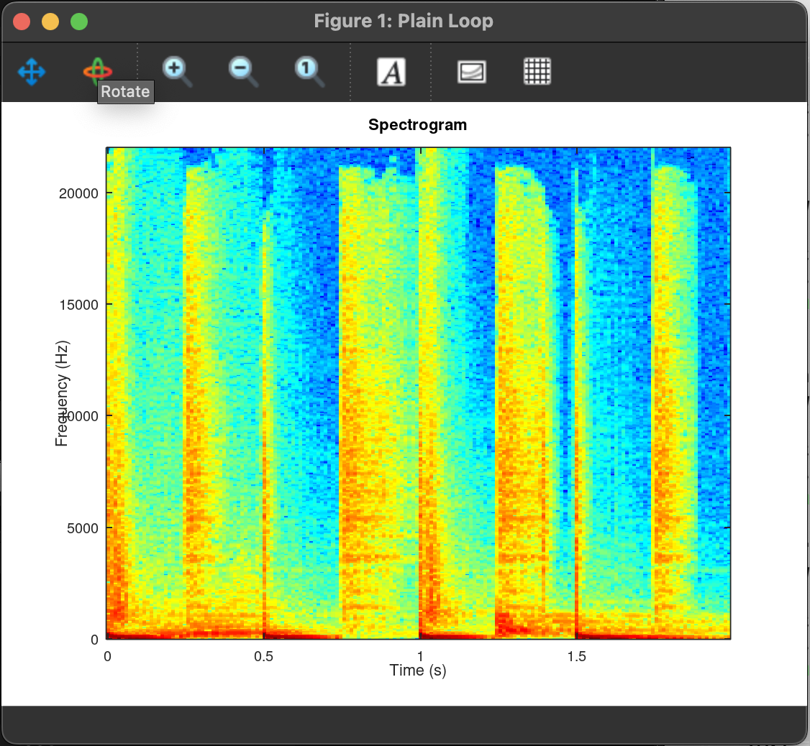
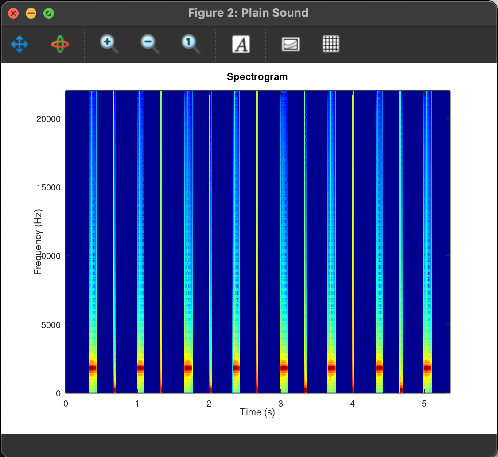
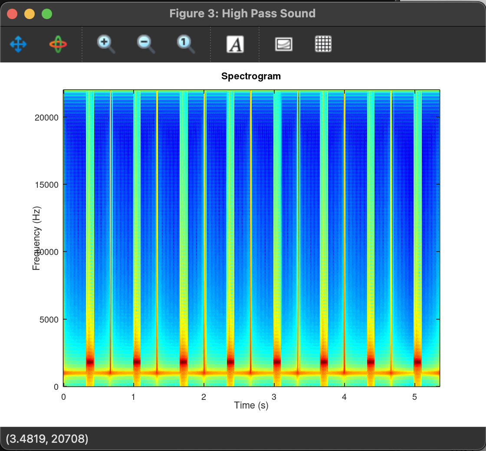
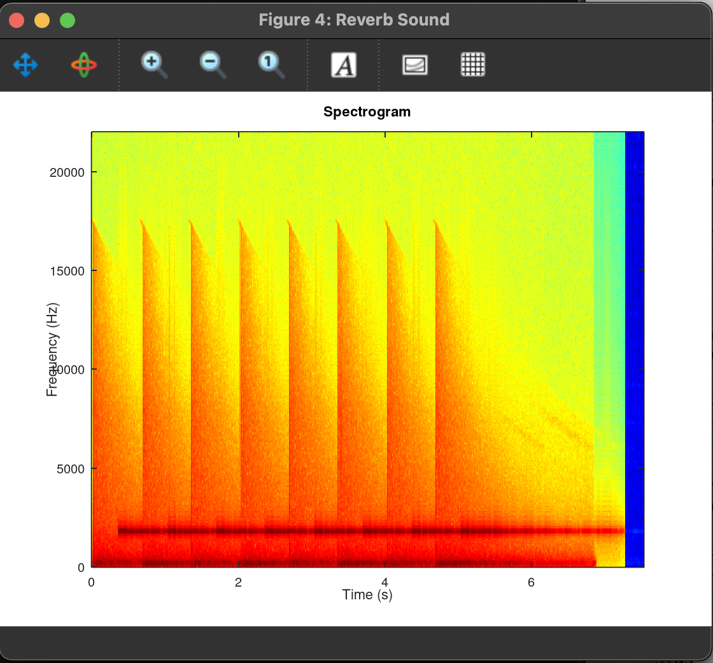
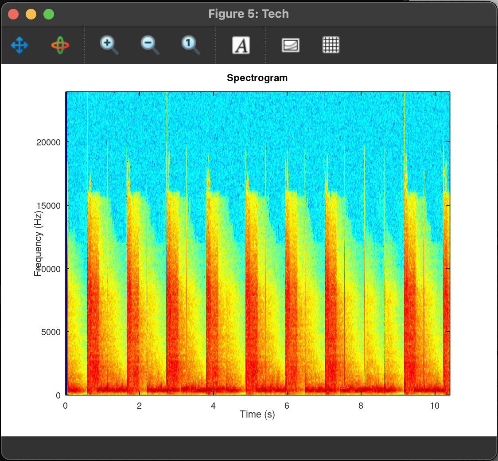
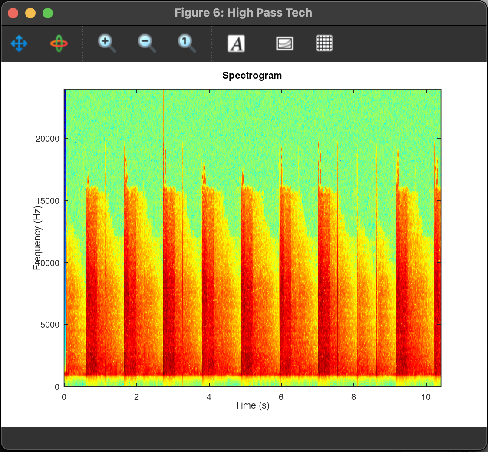
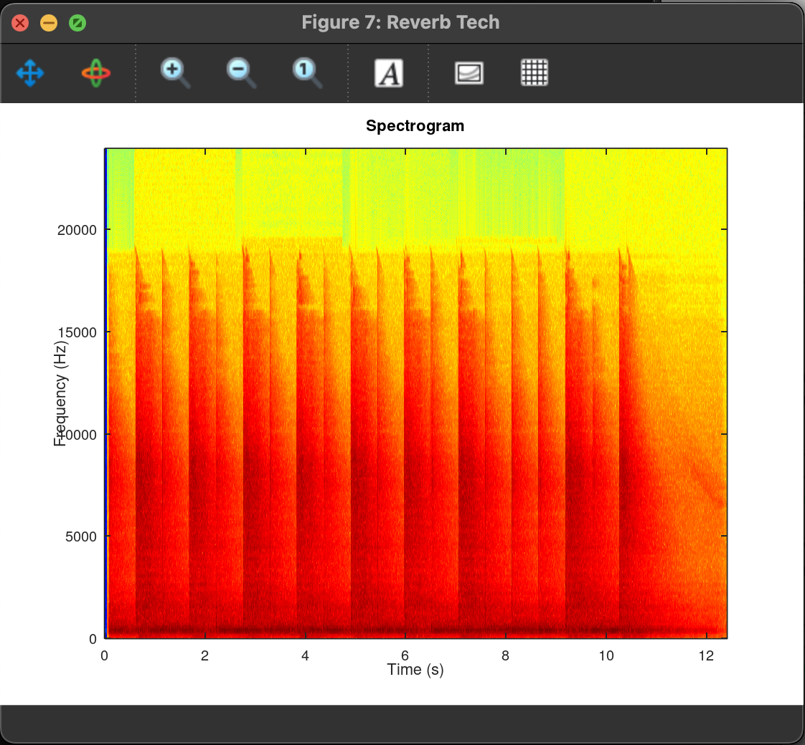
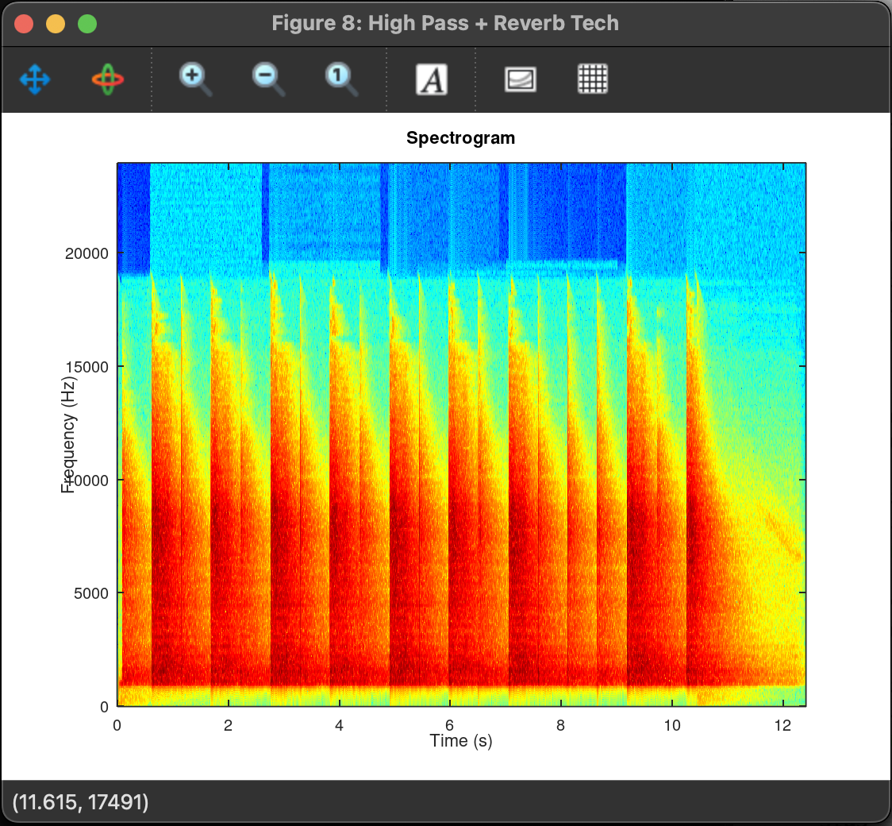
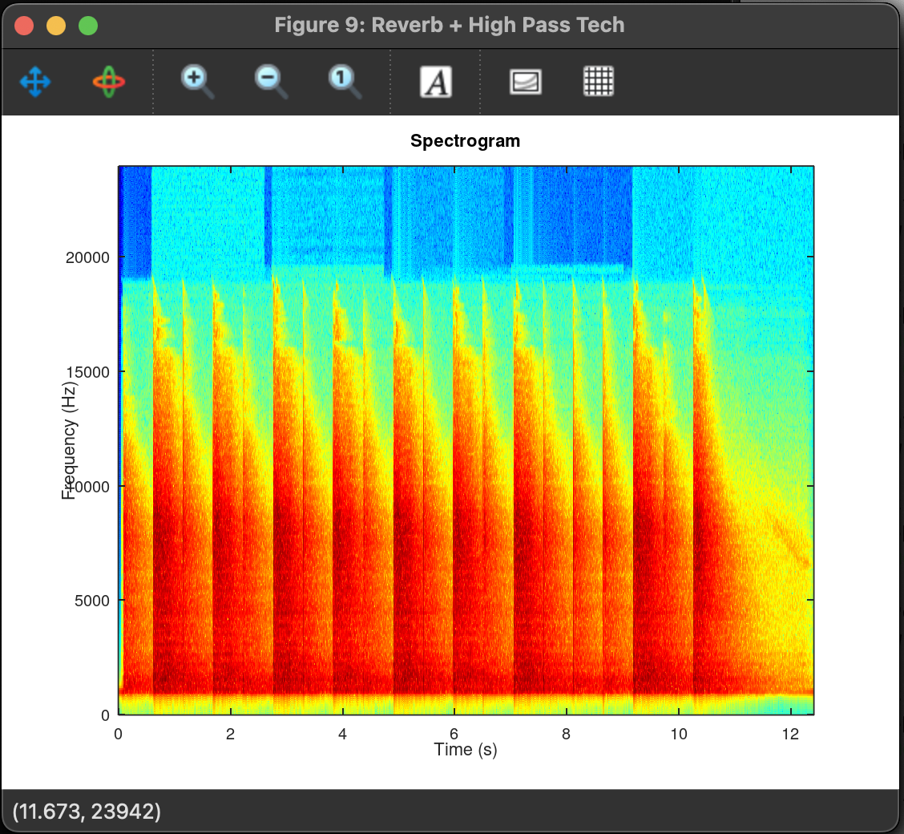

<h1 align="center">Nume: PĂRĂU VLAD</h1>

<strong>Grupa: 312CC</strong>

<strong>Anul I</strong>

<h2>Task 1: Numerical Music</h2>

  
  
  
  
  
  
  
  
  

 

Analizand pozele de mai sus impreuna cu functiile din acest task, am observat urmatoarele:
#### 1. Plain loop
- Bucata de tobe inregistrata (loop.wav) e foarte complexa: are energie pe toate frecventele de la 0 Hz pana aproape de 22 kHz.
- Sunetele de tobe si hihat genereaza mult zgomot si armonici care umplu spectrul. Prin urmare spectrograma arata un nor dens de rosu-galben de jos pana sus.

#### 2. Plain sound
- Semnalul generat din music1.csv e compus din tonuri sintetice (kick-uri și hihat-uri digitale). Acolo, energia se gaseste doar la frecventele fundamentale si armonicele lor (linii subtiri verticale, bine conturate).
- Peste 8–10 kHz nu apare aproape nimic (spatiul e albastru), pentru ca nu exista zgomot de inalta frecventa în sinteta.

#### 3. High Pass Sounds
- Sunetul devine subtire, fara bass (nu mai simti lovitura profunda a kick-ului).
- Raman doar acele linii verticale subtiri care erau frecvente de peste 1 kHz (armonici inalte, ciocanituri de hihat și zgomote scurte).

#### 4. Reverb sound
- Un raspuns in timp (impulse-response) aplicat semnalului – practic fiecare sunet clasic de tip „pop” sau „tic” se intinde, se intinde ca un ecou.
- In loc de linii verticale foarte scurte (transientele din Plain Sound), ai niste linii oblice, inclinate, care pornesc sus si coboara treptat pana jos.
- Sunetul pare mai spatial, mai plin, notele se „intind” si umplu spatiul dintre batai, nu mai au contur atat de rigid.

#### 5. Tech
- Efect tech - filtru cu rezonanta si modulare rapida
- Noi benzi laterale: langa liniile armonicelor fundamentale apar alte linii paralele, semn ca semnalul a fost modulata in frecventa (sau amplitudine).
- Rezonanta filtrului accentueaza anumite frecvente, ceea ce se vede ca “puncte” de culoare intensa in spectograma.

#### 6. High Pass Tech
- Mai intai filtrul trece-sus (cutoff 1 kHz) elimina complet tot bass-ul din “Plain Sound”.
- Apoi reverberatia (convolutie cu impulse-response) intinde doar frecventele ramase, creand cozi temporale exclusive in inalte.
- Sunetul este aerat si clar in zona medie-inalta, fara interferente joase in ecou.

#### 7. Reverb tech
- Se aplica intai reverberatia pe tot spectrul, obtinand cozi pline pe toate frecventele.
- Apoi high-pass taie componentele sub 1 kHz din coada ecoului, “cioplind” abrupt fiecare traiectorie.
- Rezultatul este un ecou initial cald si complet, urmat de disparitia rapida a bass-ului.

#### 8. High Pass + Reverb Tech
- Pornind de la “Tech Sound” (cu benzile laterale si rezonante), high-pass (1 kHz) indeparteaza toate fundamentalele si partea joasa a modificarilor semnalelor.
- Spectrograma ramane cu acele armonici si sidebands peste 1 kHz, exact unde LFO-ul a generat continut extra.
- Sunetul final este un “tech” cristalizat in inalte, fara nicio urma de bass.

#### 9. Reverb + High Pass Tech
- Plecand de la “Tech Sound” uscat, reverberatia intinde in timp fiecare transient si fiecare banda laterala generata de modulare.
- Spectrograma afiseaza traiectorii oblice care se estompeaza gradual, pentru fiecare armonica si sideband.
- Sunetul devine mai spatios si complex, pastrand toate caracteristicile techno initiale, dar cu cozi de ecou pe fiecare banda.